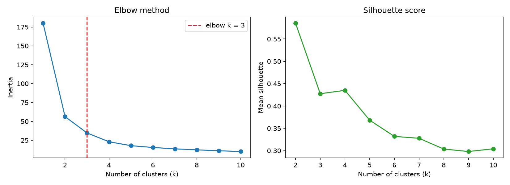
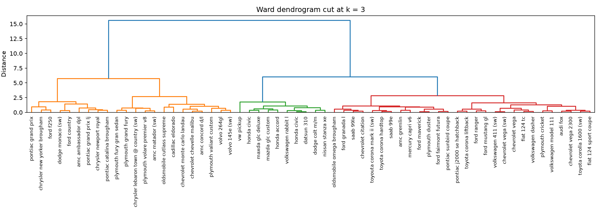

# Choosing the Number of Clusters: Elbow, Silhouette, K-Means and Dendrograms


A small, tested toolkit that answers a question every clustering project starts with:
**how many clusters should I use?** It combines three views of the same data:

1. the **elbow method** (inertia vs. k), with an automatic elbow detector,
2. the **silhouette score**, a second, independent criterion,
3. a **Ward dendrogram** cut at the chosen k.

## Example (real run)

Dataset: seaborn's `mpg` cars, features `mpg`, `horsepower`, `weight`, random sample of 60
cars, standardized features, seed 42.

| Criterion | Result |
|---|---|
| Elbow (automatic) | **k = 3** |
| Best silhouette | k = 2 (0.59), with a second local peak at k = 4 |
| K-Means cluster sizes at k = 3 | 25 / 14 / 21 |

The two criteria disagree, and that is the honest lesson: the data has a strong 2-group
structure (small economical cars vs. large heavy ones) that splits further into 3 groups.
Always check more than one criterion and use domain knowledge to choose.





## Design decisions

- **Standardized features.** K-Means and Ward linkage use Euclidean distance; without
  scaling, `weight` (thousands) would drown `mpg` (tens). Median imputation handles the
  missing `horsepower` values.
- **Deterministic.** Every random step takes a `seed`.
- **Separation of concerns.** `core.py` has no plotting or I/O, so it is unit-tested;
  `plots.py` draws; `cli.py` wires them together.

## Install and run

```bash
pip install -e ".[dev]"
python -m clustering_demo --sample 60 --out reports        # uses seaborn's mpg
python -m clustering_demo --csv my.csv --features a b c    # your own data
```

Outputs `elbow.png`, `dendrogram.png` and `summary.json` in the output directory.

## Tests

```bash
pytest -q && ruff check .
```

The tests build synthetic blobs with a known number of clusters and verify that the elbow
detector and the silhouette both recover it, that results are reproducible, and that the
CLI runs end to end.

## Project layout

```
src/clustering_demo/   core.py (algorithms) · plots.py · cli.py
tests/                 pytest suite
docs/                  figures shown above
```

## Author

**Márcio Belloni**, AI/ML Engineer.
[LinkedIn](https://www.linkedin.com/in/marcio-belloni/) · [GitHub](https://github.com/devbelloni)
